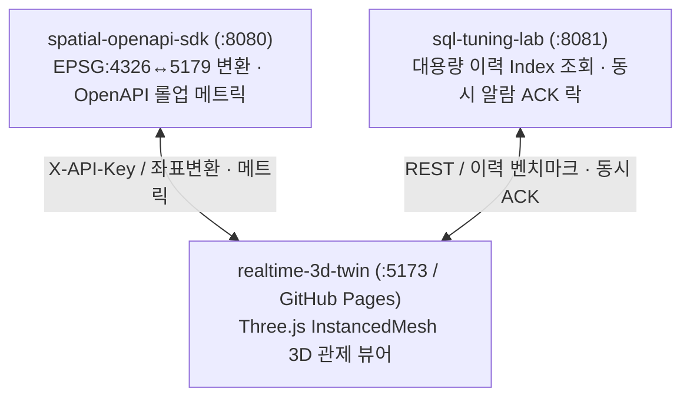

# realtime-3d-twin

[](https://github.com/duduri97/realtime-3d-twin/actions/workflows/deploy.yml)

**라이브 데모**: https://duduri97.github.io/realtime-3d-twin/

Three.js **`InstancedMesh` 기반 대규모 3D 디지털 트윈 렌더링 최적화 + 실시간 센서 알람 관제 뷰어**입니다.  
단독 시뮬레이션(**Standalone**)은 물론, 로컬 백엔드 2종과 자동으로 연결되는 **Dual-Mode 생태계 아키텍처**로 설계되었습니다.

## Dual-Mode 아키텍처 (3-Repo 연동)



- **Standalone 모드 (GitHub Pages 기본)**: 백엔드 서버 없이도 브라우저 단독으로 2,500대 설비 `InstancedMesh` 렌더링과 실시간 알람 포커싱을 즉시 체험할 수 있습니다.
- **Connected 모드 (`:8080` · `:8081` 실행 시 자동 활성화)**:
  1. 설비/알람 클릭 시 `spatial-openapi-sdk(:8080)`를 호출해 **WGS84 → `EPSG:5179(UTM-K)` 좌표 변환** 및 **OpenAPI 롤업 로그 절감률**을 표시합니다.
  2. 동시에 `sql-tuning-lab(:8081)`을 호출해 해당 설비 이력의 **Full Scan vs Composite Index 응답시간**을 비교하고, **8건 동시 알람 ACK(비관적/낙관적 락)** 스트레스 테스트를 바로 실행할 수 있습니다.

## 빠른 실행

```bash
# 단독 실행
npm install
npm run dev
```

### 3개 레포 전체 연동 실행

```bash
# 터미널 1 — 공간정보 OpenAPI (:8080)
cd ../spatial-openapi-sdk && ./mvnw spring-boot:run

# 터미널 2 — 대용량 이력 & 동시성 백엔드 (:8081)
cd ../sql-tuning-lab && ./mvnw spring-boot:run

# 터미널 3 — 3D 디지털 트윈 뷰어 (:5173)
npm run dev
```
